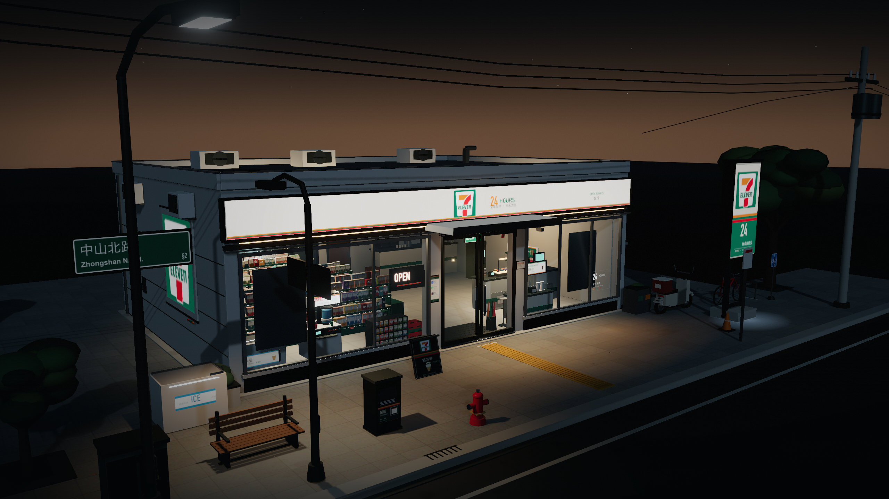
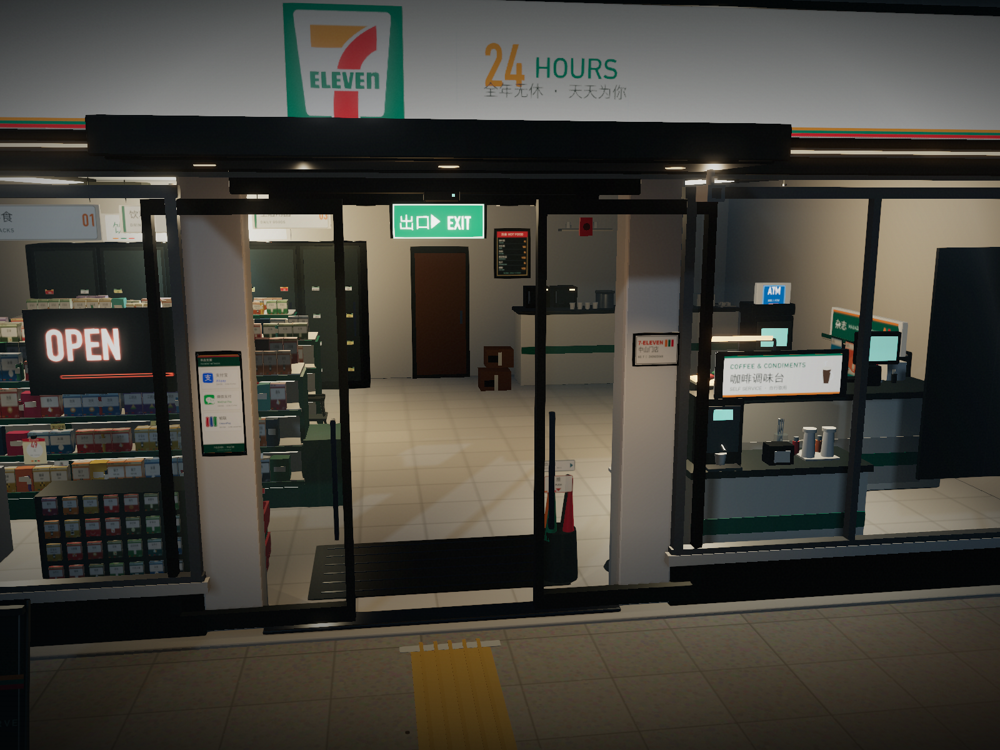

# 7-ELEVEN · 街角便利店 3D

一个街角 7-ELEVEN 便利店的 3D 场景。**Blender 程序化建模 + Three.js 即时渲染**，包含可编辑的 `.blend` 场景、通用 `.glb` 模型，以及一个不需要网络、直接把模型与场景塞进去的单文件互动网页。所有价格、收据与咖啡卡统一以人民币（¥）标示。

**线上体验：** <https://xiaohu65.github.io/seven-eleven-store-3d/>

默认载入**当前本地时间**，可切换 **日间 / 夜晚**，也可拖动 24 小时日光时间轴。走进店内，可沿店内导览走到冷藏饮料、零食与日用品货架，把商品放进购物袋；也能直接点一杯咖啡。两者都以 **Alipay / WeChat Pay / 银联** 模拟支付，并下载电子消费明细。店面周边刻意留白，不放置其他建筑，让 7-ELEVEN 成为街道唯一的主体。



## 快速开始

| 我想…… | 打开 |
| --- | --- |
| 直接在浏览器线上体验 | **<https://xiaohu65.github.io/seven-eleven-store-3d/>** |
| 直接在浏览器看 3D、店内走动购物、点咖啡与切换日夜 | [`7-11便利店-3D交互.html`](7-11便利店-3D交互.html)（或 [`7-eleven-store-3d.html`](7-eleven-store-3d.html)） |
| 导入 Blender / Three.js / Unity / Unreal | [`seven_eleven_store.glb`](seven_eleven_store.glb) |
| 打开完整灯光、相机与可编辑场景 | [`seven_eleven_store.blend`](seven_eleven_store.blend) |
| 只要干净模型（无灯光、无相机） | [`build/seven_eleven_store_asset.blend`](build/seven_eleven_store_asset.blend) |

互动网页是**单一 HTML 文件**：Three.js、全部贴图与 GLB 都内嵌其中，不需要启动服务器，也不需要网络。建议使用最新版 Chrome、Safari 或 Edge；需要 WebGL 2。

## 日光、黄昏与夜晚

| 模式 | 内容 |
| --- | --- |
| **日间 DAY** | 偏暖的清晨日照、低角度长投影、较白的玻璃反光与偏冷阴影；店内灯仍亮着，但退到白天之后。 |
| **黄昏 DUSK** | 时间轴中段，低角度金色光线、较长的阴影与开始亮起的店招；室内灯与路灯逐步接管街道。 |
| **夜晚 NIGHT** | 深蓝夜空、星光、地平线微光、发光的店招与骑楼；室内暖光穿过玻璃，在骑楼留下光池。 |

模式切换或拖动时间轴时，天空、雾、曝光、Bloom、灯光与自发光材质会连续混合过渡，不是硬切。默认开场会推近店面；鼠标／手指一碰就会停下自动环绕。

## 互动

- **走进店内**：点玻璃门、右下角（手机右上角）的门图示，或按 `E`。镜头会沿固定路径穿过自动滑门，进入店内后可拖动环顾；再按 `E`、`Esc`、点门图示，或直接点玻璃门/门口回到街角。
- **自动门**：两扇完整玻璃门会随镜头接近或入店而滑开，门框、把手与玻璃一起移动；离店后自动关闭。
- **光线时间轴**：LIGHTING 面板下方的 0–24 时轨道默认停在当前时间；拖动即可在晨光、日间、黄昏与夜晚之间连续变化，日／夜按钮仍是快速跳转。
- **拍照模式**：按 `P` 或右上角相机图示，隐藏 UI 后自由取景；按「保存 PNG」下载干净的即时渲染画面。
- **店内走动**：进店后，左下角「店内导览」或画面上的货架标签可把镜头滑到 **入口 / 冷藏饮料 / 零食 / 日用品** 四个观察点；这是导轨式移动，不需要自由寻路，也不会穿过货架。
- **购物袋**：走到货架会打开对应分类；商品可加入购物袋、调整数量，再进入结账。购物袋只装货架商品。
- **深夜咖啡**：进店后点画面下方的「点咖啡」或按 `C`。单杯直接结账，不加入购物袋；可选美式、拿铁、卡布奇诺、摩卡与热／冰，支付方式为 Alipay、WeChat Pay、银联。完成模拟支付后可下载电子消费明细与深夜咖啡卡。
- **自动旋转、重置、信息**：右侧工具列；快捷键为空格键、`R`、`I`。
- **移动端**：门图示、拍照、咖啡、购物、路线与时间轴都保留；店内以单指拖动环顾。

## 店内走动与购物

店内采用**导轨式点击走动**：不是自由碰撞移动，而是把相机滑到事先安排好的货架观察点。这样能靠近货架、保留建筑视角，又不需要在狭窄的店内做寻路与碰撞。

| 路线 | 对应分类 |
| --- | --- |
| 入口 | 回到店内初始视角 |
| 冷藏饮料 | 冷饮与瓶装饮料 |
| 零食 | 洋芋片、巧克力、苏打饼 |
| 日用品 | 安全套、湿纸巾、打火机 |

入口可从左下角「店内导览」或画面中的货架标签进入。走到货架后会自动打开对应分类；也可以按 `S` 或点下方「逛货架」直接开购物面板。

### 商品与购物袋

| 分类 | 商品 | 价格（人民币） |
| --- | --- | --- |
| 冷藏饮料 | 冷萃绿茶 / 深夜可乐 / 矿泉水 | ¥6 / ¥4 / ¥2 |
| 零食 | 海盐洋芋片 / 黑巧克力 / 起司苏打饼 | ¥7 / ¥9 / ¥6 |
| 日用品 | 安全套 / 湿纸巾 / 打火机 | ¥18 / ¥5 / ¥3 |

购物袋支持数量加减、移除、总额与结账；结账时可勾选 **X用户 8.8 折**（本地模拟 X 用户优惠）。支付成功后会产生一张 **电子购物明细 PNG**，内含多行品项、数量、单价、总额、支付方式、订单号与「非实际交易」标示。购物明细可下载；本版本没有另外制作购物卡。

咖啡与购物是**两笔独立订单**：咖啡永远不会进入购物袋。

两笔结账都可以选择 **X用户 8.8 折**；折后金额会同步写入电子明细。

## 深夜咖啡

店内限定的单杯自助流程；咖啡维持独立结账，不加入购物袋，也不连接真实支付服务。价格单位为人民币（¥）。

| 品项 | 价格（人民币） | 选项 |
| --- | --- | --- |
| 美式 Americano | ¥12 | 热／冰 |
| 拿铁 Latte | ¥16 | 热／冰 |
| 卡布奇诺 Cappuccino | ¥16 | 热／冰 |
| 摩卡 Mocha | ¥18 | 热／冰 |

1. 进店后按 `C` 或点下方咖啡 CTA。
2. 选品项与热／冰，直接前往付款。
3. 选择 **Alipay、WeChat Pay 或银联**；画面会显示模拟扫码与交易状态。
4. 完成后产生两份可下载的 PNG：
   - **电子消费明细**：720 × 1190，热感纸风格，含订单号、时间、品项、金额、支付方式、条码与「非实际交易」标示。
   - **深夜咖啡卡**：1080 × 1350，含咖啡杯插画、品项、订单号、日期与付款方式，适合作为数字收藏或分享。

所有订单号、QR 图样、金额与时间都在浏览器本地产生；没有后端、没有真实扣款、也不会寄送 email。下载即为「领取」电子明细与咖啡图片。结账时勾选「X用户 8.8 折」，折后金额会同步写入收据与咖啡卡。

## 店面细节

- **玻璃与入口**：大面清玻璃、铝框分割、双开滑门、金属把手、自动门感测器、入口刮泥垫、门外雨遮与嵌灯；玻璃上另有自动门与推门指示贴纸。左侧门框新增垂直支付牌，依序标示 **Alipay、WeChat Pay、银联 / UnionPay**。
- **招牌与标示**：白底发光招牌、7-ELEVEN 标志、橘／绿／红条纹、双面户外灯箱、侧墙标志、A 字牌、门牌铭板、支付方式牌与玻璃反光。
- **柜台与服务**：收银台、POS 屏幕、刷卡机、扫描器、出单机、热食保温柜、关东煮／茶叶蛋加热器、微波炉、咖啡机、杯盖与纸袋。
- **自取与陈列**：**思乐冰机**（双槽、透明罩、彩色冰沙、出料把手与发光标头）、**咖啡调味台**（咖啡机、杯塔、杯盖、吸管、糖包、糖浆瓶与悬挂式灯箱）、**杂志／报纸架**、冷藏饮料柜、冰品柜。
- **货架与商品**：三排绿色货架、以 64 款包装图集贴图构成的分组陈列、饮料罐、冷藏瓶装饮料、货架边价格牌、冰箱价格条、悬挂促销牌与端架陈列。
- **便利设施与营运痕迹**：**ATM / 多媒体机台**、**购物篮堆叠**、**绿色出口指示灯**、伞架、入口消毒架、备货铝梯、遗留在走道的购物篮、后场纸箱与封箱胶带、天花板通风口／洒水头／烟雾侦测器。
- **外墙与招牌**：主横幅招牌以较柔和的亮度呈现，降低死白并保留字样与颜色；独立灯箱使用较粗糙的表面，移除局部反光热点；招牌有金属收边、支架与门牌，玻璃反射与室外光池维持可读性。
- **街道与人行道**：导盲砖、木长椅、报纸贩卖箱、消防栓、变电箱、脚踏车与车架、自行车停放牌、行人路灯、街道名牌、交通锥、植栽、路树、机车、A 字牌、垃圾分类桶、架空线、排水沟与人孔盖；地面加入落叶、口香糖痕、污渍与香烟蒂等生活痕迹。
- **灯光**：天花板灯槽、货架下缘灯条、冰柜背光、柜台与窗边重点光、骑楼与招牌光池；街道另有人行尺度路灯与 7-ELEVEN 灯箱光。



## 场景一览

| 项目 | 参数 |
| --- | --- |
| 类型 | 街角 7-ELEVEN 便利店场景，台湾街景气质 |
| 店面 | 约 **13.2 × 9.6 m**，簷高约 4.7 m；独立式招牌塔楼高约 5.1 m |
| 三角面 | 约 **71,194** |
| 网格物件 | 628 个（Blender 原始场景；网页载入后会自动合并为较少 draw call） |
| 贴图 | 38 张内嵌图像（GLB 内） |
| 模型单位 | 米；Blender 为 Z-up，glTF 为 Y-up |
| GLB 大小 | 约 7.3 MiB |
| 单档网页 | 约 11 MiB（内嵌 Three.js、GLB、贴图与 UI） |
| 默认时间 | **当前本地时间**（可用 `?mode=day` / `?mode=night` 固定截图） |

## 操作

- **拖动**：环绕；**滚轮／双指**：缩放。
- **双击画面**或右上「重置」：回到默认视角。
- **「日间」／「夜晚」**：快速切换光线，快捷键 `1` / `2`；中间的晨光与黄昏用 0–24 时时间轴拖动，默认停在当前时间。
- **入店**：点玻璃门、门图示或按 `E`；店内拖动环顾，`Esc`／`E` 返回。
- **拍照**：`P` 进出拍照模式，按「保存 PNG」下载。
- **店内走动**：点左下角「店内导览」或货架标签，前往入口、冷藏饮料、零食或日用品。
- **购物**：按 `S` 或点「逛货架」；加入购物袋、调整数量、结账，完成后下载购物明细。按 `B` 可直接打开购物袋。
- **咖啡**：店内按 `C` 或点「点咖啡」；选品项、热冰与支付方式，完成后下载明细与咖啡卡。
- **自动旋转**：右侧转盘按钮，`空格键` 开关；一旦手动拖动即停止。
- **`i`**：关于模型与场景。
- **`Esc`**：关闭目前面板；店内按 `Esc` 先关闭购物／咖啡／说明，再离开店内。
- 主画面不显示快捷键徽标；完整的键盘操作列在 **ABOUT THE STUDY** 弹窗中。

## 图片

| 文件 | 说明 |
| --- | --- |
| [`renders/seven-eleven-night-hero.png`](renders/seven-eleven-night-hero.png) | 夜晚主视觉（2560 × 1440） |
| [`renders/seven-eleven-dusk.png`](renders/seven-eleven-dusk.png) | 黄昏光线时间轴（2560 × 1440） |
| [`renders/seven-eleven-day-hero.png`](renders/seven-eleven-day-hero.png) | 日间主视觉（2560 × 1440） |
| [`renders/seven-eleven-viewer.png`](renders/seven-eleven-viewer.png) | 即时页面与 UI 截图 |
| [`renders/seven-eleven-instore-route.png`](renders/seven-eleven-instore-route.png) | 店内导览、货架标签与服务列（2560 × 1440） |
| [`renders/seven-eleven-shop.png`](renders/seven-eleven-shop.png) | 购物分类、商品与购物袋（1600 × 1200） |
| [`renders/seven-eleven-shop-pay.png`](renders/seven-eleven-shop-pay.png) | 购物结账、X 用户折扣与支付方式（1600 × 1200） |
| [`renders/seven-eleven-shop-receipt-demo.png`](renders/seven-eleven-shop-receipt-demo.png) | 电子购物明细范例（720 px 宽） |
| [`renders/seven-eleven-coffee-order.png`](renders/seven-eleven-coffee-order.png) | 深夜咖啡点单面板（1600 × 1200） |
| [`renders/seven-eleven-coffee-pay.png`](renders/seven-eleven-coffee-pay.png) | 咖啡结账与「X用户 8.8 折」选项（1600 × 1200） |
| [`renders/seven-eleven-coffee-receipt-demo.png`](renders/seven-eleven-coffee-receipt-demo.png) | 电子消费明细范例（720 × 1190） |
| [`renders/seven-eleven-coffee-card-demo.png`](renders/seven-eleven-coffee-card-demo.png) | 深夜咖啡卡范例（1080 × 1350） |
| [`renders/seven-eleven-interior.png`](renders/seven-eleven-interior.png) | 走进店内后的货架、冷柜与柜台视角（2560 × 1440） |
| [`renders/seven-eleven-detail.png`](renders/seven-eleven-detail.png) | 店面入口、出口指示与咖啡调味台细节（1600 × 1200） |
| [`renders/seven-eleven-detail-slurpee.png`](renders/seven-eleven-detail-slurpee.png) | 思乐冰机与左侧窗景细节（1600 × 1200） |
| [`renders/seven-eleven-detail-street.png`](renders/seven-eleven-detail-street.png) | 长椅、报纸箱、消防栓、导盲砖与路灯（1600 × 1200） |
| [`renders/seven-eleven-detail-payment.png`](renders/seven-eleven-detail-payment.png) | 左侧门框的 Alipay／WeChat Pay／银联支付牌（1600 × 1200） |
| [`renders/seven-eleven-mobile.png`](renders/seven-eleven-mobile.png) | 手机版排版 |

图片由无头 Chrome 对同一个互动页面即时截取，使用与网页一致的光照、雾与后处理。

## 文件结构

```
seven_eleven_store/
├── 7-11便利店-3D交互.html          # 单档互动页（推荐）
├── 7-eleven-store-3d.html          # 同一页面的 ASCII 档名
├── seven_eleven_store.glb          # 通用 glTF 2.0 模型（含场景与贴图）
├── seven_eleven_store.blend        # 完整夜景灯光、相机与素材
├── build/
│   └── seven_eleven_store_asset.blend  # 干净模型（建议作为汇入起点）
├── textures/                       # 程序化生成与招牌贴图
├── scripts/                        # Blender 建模、贴图、GLB 汇出、打包与截图
├── viewer/src/                     # Three.js 原始码、UI 模板与样式
├── renders/                        # 终稿截图
├── README.md
├── LICENSE.md
└── THIRD_PARTY_NOTICES.md
```

### Blender 与 GLB 使用提示

- `.blend` 已把贴图打包进文件，可以单独搬移；建议用 Blender 5.2+ 开启。
- 模型集含 `Seven_Eleven_STORE_ROOT` 根 Empty 与按用途命名的集合（Site、Shell、Glazing、Interior、Signage、Props 等），方便隐藏或替换。
- GLB 为 glTF 2.0、Y-up、米制；材质为 PBR，招牌、玻璃、霓虹与室内灯使用 `KHR_materials_emissive_strength`，透明玻璃使用 alpha blend。
- 网页载入后会把不透明的静态网格按材质合并，以降低 draw call；`.blend` 与 `.glb` 仍保留完整场景与材质。
- 7-Eleven 的名称与标志属于其权利人；此专案为独立的艺术研究，并非官方店铺或广告。

## 技术细节

- **Blender 5.2.3 LTS / Python**：程序化生成店面、玻璃分割、室内货架与商品、冷藏柜、柜台、自取设备、备货杂物、街道家具、机车、脚踏车与路树；主要建筑与街道家具加入 1.2 cm 倒角，PBR 材质与透明玻璃直接输出 glTF。
- **Pillow**：招牌、海报、菜单、街牌、思乐冰／调味台灯箱、出口指示、门贴、Alipay／WeChat Pay／银联支付牌、自行车停放牌、店面门牌、杂志封面、报纸箱、商品包装图集、价格标签、污渍、磁砖、柏油与混凝土贴图全由脚本绘制。
- **Three.js r180**：GLTFLoader、OrbitControls、EffectComposer、UnrealBloomPass、SMAAPass、OutputPass；自写天空着色器、星空、玻璃反光、地面光池与环境 map；加入连续日光／黄昏／夜晚参数插值、可动玻璃门与固定路径入店视角。
- **互动层**：pointer raycast 点门入店、店内拖动环顾、拍照模式与 canvas PNG 下载；深夜咖啡以本地状态机完成选品、三种支付方式、模拟扫码与 HTML Canvas 明细／咖啡卡生成。店内导轨走动以屏幕投影的货架标签与相机 tween 实现，购物袋、三种支付与购物明细同样在本地完成；所有状态仍离线运作。
- **esbuild**：把 Three.js、GLB（data URL）与贴图打包成单一 HTML。
- **Lucide**：界面图标采用 Lucide Static v1.70.0（ISC），在页面内以 inline SVG 呈现，不依赖外部 CDN。
- **Puppeteer + headless Chrome（ANGLE/Metal）**：输出日间与夜晚截图。

### 重新建置

```bash
# 1) 贴图
python3 scripts/make_textures.py

# 2) 模型与灯光场景（macOS Blender 路径）
/Applications/Blender.app/Contents/MacOS/Blender -b --factory-startup \
  --python scripts/build_model.py
/Applications/Blender.app/Contents/MacOS/Blender -b --factory-startup \
  --python scripts/export_glb.py

# 3) 单档网页
npm install
npm run build:viewer

# 4) 截图（可选）
node scripts/capture.js all
```

## 关于此作品

这是一间**街角便利店场景**。店面比例、街景、商品与光线都是为这个独立场景设计的。周边不设置其他建筑，目的是让店面成为唯一主体。7-ELEVEN 与其标志是 7-Eleven, Inc. 的商标；本专案与其无隶属关系，仅作为独立的 3D 光影与建筑研究。详细授权与第三方素材见 [`LICENSE.md`](LICENSE.md) 与 [`THIRD_PARTY_NOTICES.md`](THIRD_PARTY_NOTICES.md)。

*程序化街角研究 · 2026*
